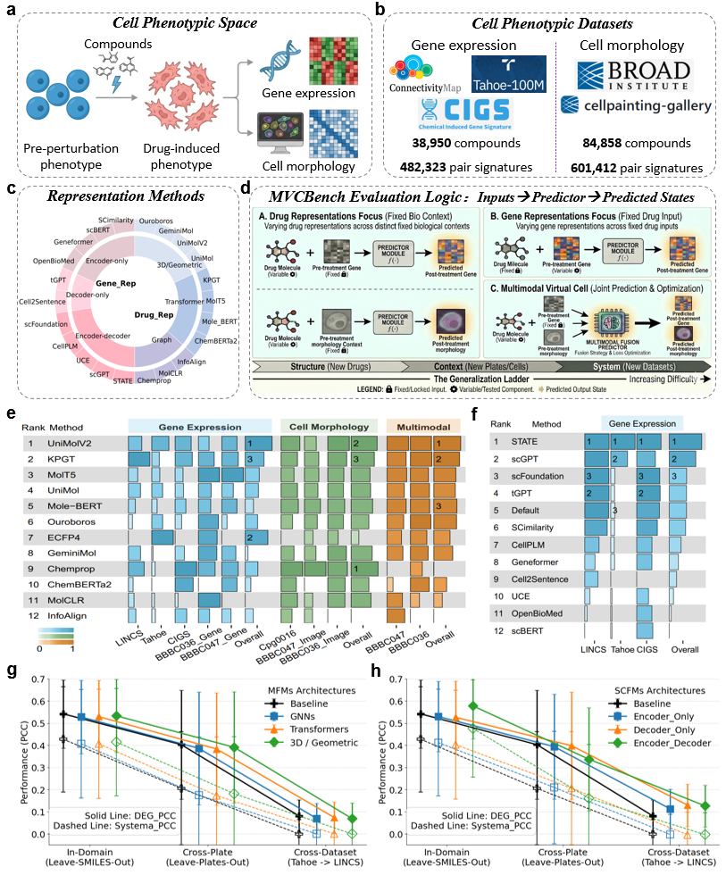
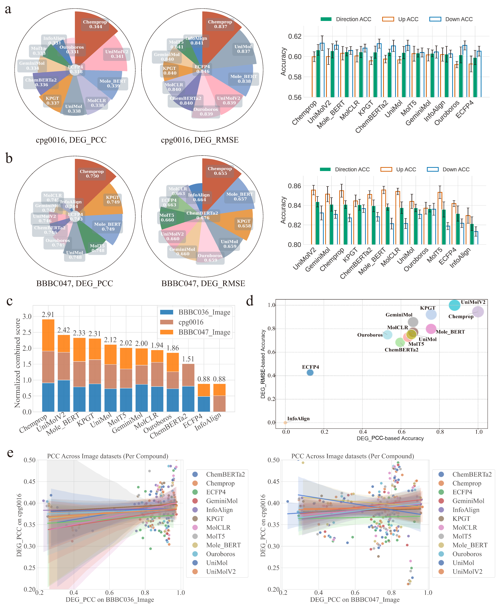
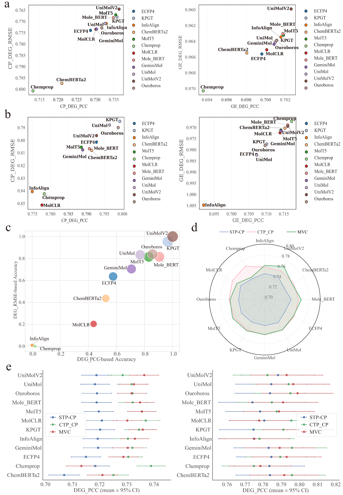

<div align="center">

<h1>🧬 MVCBench</h1>

<h3>A Multimodal Benchmark for Drug-induced Virtual Cell Phenotypes</h3>

<p>
  <strong>Which molecular and gene representations work, for which cellular readouts, and under which evaluation settings?</strong>
</p>

<p>
  🧪 <strong>Molecular representations</strong> &nbsp;·&nbsp;
  🧬 <strong>Gene representations</strong> &nbsp;·&nbsp;
  🔬 <strong>Transcriptomics</strong> &nbsp;·&nbsp;
  🖼️ <strong>Cell morphology</strong>
</p>

<p>
  <a href="https://qsong-github.github.io/MVCBench/"></a>
  <a href="https://www.biorxiv.org/content/10.64898/2026.04.22.720110v1"></a>
  <a href="https://huggingface.co/datasets/Boom5426/MVCBench"></a>
</p>

<p>
  
  <a href="https://doi.org/10.5281/zenodo.23733476"></a>
  <a href="https://www.python.org/"></a>
  <a href="LICENSE"></a>
  <a href="https://github.com/QSong-github/MVCBench/stargazers"></a>
</p>

<p>
  <a href="https://qsong-github.github.io/MVCBench/">🌐 <b>Project Page</b></a>
  &nbsp;•&nbsp; <a href="https://www.biorxiv.org/content/10.64898/2026.04.22.720110v1">📄 <b>Read the Paper</b></a>
  &nbsp;•&nbsp; <a href="https://huggingface.co/datasets/Boom5426/MVCBench">🗂️ <b>Dataset</b></a>
  &nbsp;•&nbsp; <a href="#quickstart">⚡ <b>Quickstart</b></a>
  &nbsp;•&nbsp; <a href="#citation">📝 <b>Citation</b></a>
</p>

</div>


---

<a id="overview"></a>
## 🎯 Overview

**MVCBench** systematically studies how **drug molecular** and **gene** representations influence prediction of drug-induced cellular phenotypes across **transcriptomic**, **morphological**, and **multimodal** settings. Rather than declaring one encoder universally best, MVCBench asks **which representation helps a particular readout and how well that advantage generalizes**.

<div align="center">

| 🧫 Drug-induced profiles | 🧪 Molecular representations | 🧬 Gene representations | 🔬 Evaluation stages |
|:---:|:---:|:---:|:---:|
| **~1.1 million** | **12** | **12** | **3** |

<a href="https://qsong-github.github.io/MVCBench/"></a>

<sub><b>Figure 1.</b> MVCBench integrates drug-perturbation resources and evaluates representation choices in a progressive benchmark, from individual response modalities to multimodal modeling. Click the figure to explore the project website.</sub>

</div>

> [!NOTE]
> **What “multimodal” means here:** The transcriptomic and morphological resources are not universally measured in the same cells, plates, or experimental replicates. When readouts come from different experiments, cross-modality correspondence may be established at the **compound level**. Do not interpret the total profile count as same-cell RNA–image pairs.

<a id="findings"></a>
## ✨ Key Findings

| | Research question | What MVCBench finds |
|:---:|---|---|
| 🧪 | **Do stronger molecular encoders help all phenotypes equally?** | Gains are substantially more pronounced for **morphology prediction** than for **gene-expression prediction**, where simpler fingerprints can remain competitive. |
| 🧬 | **Are general-purpose gene foundation models always preferable?** | **Task alignment matters.** In the evaluated transcriptomic settings, perturbation-oriented representations can outperform more general encoders. |
| 🔗 | **Does multimodal training help?** | Joint optimization improves results in the evaluated settings, but the size and interpretation of gains depend on the dataset, readout, and optimization setup. |
| 🧭 | **What should we learn for future virtual cells?** | Representation selection, generalization splits, loss balancing, and fusion strategy need **modality-aware evaluation**, not a single aggregate ranking. |

<details>
<summary><b>📊 Show supporting results · Molecular representations (Figures 2–3)</b></summary>

<p align="center"></p>
<p align="center"><sub>Figure 2 · Drug molecular representations for gene-expression prediction.</sub></p>
<p align="center"></p>
<p align="center"><sub>Figure 3 · Drug molecular representations for cellular morphology prediction.</sub></p>
</details>

<details>
<summary><b>🧬 Show supporting results · Gene representations (Figure 4)</b></summary>

<p align="center"></p>
<p align="center"><sub>Figure 4 · Gene representation benchmarking across gene-expression prediction settings.</sub></p>
</details>

<details>
<summary><b>🔗 Show supporting results · Multimodal modeling and design principles (Figures 5–6)</b></summary>

<p align="center"></p>
<p align="center"><sub>Figure 5 · Evaluation of multimodal virtual-cell construction.</sub></p>
<p align="center"></p>
<p align="center"><sub>Figure 6 · Empirical analyses of multimodal design choices.</sub></p>
</details>

<a id="benchmark-design"></a>
## 🧭 Benchmark Design

The benchmark follows **three complementary stages** rather than collapsing different prediction questions into one score.

| Stage | Focus | Scientific question | Training entry point |
|:---:|---|---|---|
| **A** · 🧪 | **Molecular representation** | Which chemical representations support prediction of drug-induced RNA and morphology? | [`train_gene.py`](train_gene.py), [`train_image.py`](train_image.py) |
| **B** · 🧬 | **Gene representation** | How do gene encoders affect transcriptomic response prediction? | [`train_gene.py`](train_gene.py) |
| **C** · 🔗 | **Multimodal virtual cell** | When does joint RNA–morphology learning help, and under which settings? | [`train_mvc.py`](train_mvc.py) |

**Evaluation dimensions:** drug/compound, cellular context, and dataset-dependent generalization; see the [paper](https://www.biorxiv.org/content/10.64898/2026.04.22.720110v1) and [project website](https://qsong-github.github.io/MVCBench/) for the precise protocols and results.

<a id="quickstart"></a>
## 🚀 Quickstart

### 1️⃣ Set up the environment

```bash
git clone https://github.com/QSong-github/MVCBench.git
cd MVCBench

conda create -n mvcbench python=3.11 -y
conda activate mvcbench
pip install -r requirements.txt
```

### 2️⃣ Prepare benchmark data and embeddings

Download the released data from **[🤗 MVCBench on Hugging Face](https://huggingface.co/datasets/Boom5426/MVCBench)**. The loaders expect prepared datasets and, for some settings, precomputed model embeddings. They **do not automatically download every upstream resource**.

```bash
# The default data root is ./data
export VCBENCH_DATA_ROOT=/path/to/MVCBench_data
```

Dataset paths and representation file mappings are defined in [`src/configs.py`](src/configs.py). Typical resource groups include `LINCS2020`, `CIGS`, `Tahoe-100M`, `BBBC036`, `BBBC047`, `cpg0016`, and molecular representations under `Molecular_representations/`.

### 3️⃣ Run a benchmark

<details open>
<summary><b>🧬 A · Predict gene-expression responses</b></summary>

```bash
python train_gene.py \
  --dataset_name LINCS \
  --molecule_feature ECFP4 \
  --gene_encoder_type Default \
  --split_data_type smiles_split \
  --n_epochs 2 \
  --batch_size 1024
```

</details>

<details>
<summary><b>🖼️ A · Predict morphological responses</b></summary>

```bash
python train_image.py \
  --dataset_name cpg0016 \
  --molecule_feature ECFP4 \
  --image_encoder_type Default \
  --split_data_type smiles_split \
  --n_epochs 2 \
  --batch_size 1024
```

</details>

<details>
<summary><b>🔗 C · Train a multimodal virtual cell</b></summary>

```bash
python train_mvc.py \
  --dataset_name MVC_BBBC047 \
  --molecule_feature ECFP4 \
  --split_data_type smiles_split \
  --n_epochs 2 \
  --batch_size 1024
```

</details>

> [!TIP]
> These commands use **2 epochs as a smoke-test configuration**, not the training budget for reproducing published benchmark results. Supply the corresponding prepared datasets and embeddings before running. The training scripts use CUDA by default; check `--device` and available hardware as needed.

### 4️⃣ Inspect outputs

By default, training writes to `results/`, including model checkpoints (e.g., `best_model.pt`), per-sample evaluation tables (`.csv`), and predicted profiles (`.h5`) when profile export is enabled.

For benchmark sweeps, see the batch launchers:

- 🧬 [`scripts/run_gene_batch.sh`](scripts/run_gene_batch.sh)
- 🖼️ [`scripts/run_image_batch.sh`](scripts/run_image_batch.sh)
- 🔗 [`scripts/run_mvc_batch.sh`](scripts/run_mvc_batch.sh)

<a id="model-zoo"></a>
## 🧰 Representation Zoo

MVCBench evaluates **12 molecular** and **12 gene representation approaches** in the paper. The reference tables below highlight linked implementations (not a complete model inventory); availability and reproducibility may depend on upstream projects.

<details>
<summary><b>🧪 Molecular representations · View model reference table</b></summary>

| Model | Reference | Implementation |
|:---|:---|:---|
| **KPGT** | [Nature Communications · 2023](https://www.nature.com/articles/s41467-023-43214-1) | [](https://github.com/lihan97/kpgt) |
| **InfoAlign** | [ICLR · 2025](https://openreview.net/forum?id=BbZy8nI1si) | [](https://github.com/liugangcode/InfoAlign) |
| **GeminiMol** | [Advanced Science · 2024](https://advanced.onlinelibrary.wiley.com/doi/10.1002/advs.202403998) | [](https://github.com/Wang-Lin-boop/GeminiMol) |
| **Ouroboros** | [Preprint](https://www.biorxiv.org/content/10.1101/2025.03.18.643899v1) | [](https://github.com/Wang-Lin-boop/ouroboros) |
| **Mole-BERT** | [ICLR · 2023](https://openreview.net/forum?id=jevY-DtiZTR) | [](https://github.com/junxia97/Mole-BERT) |
| **ChemBERTa2** | [arXiv · 2022](https://arxiv.org/abs/2209.01712) | [](https://github.com/seyonechithrananda/bert-loves-chemistry) |
| **MolT5** | [EMNLP · 2022](https://arxiv.org/abs/2204.11817) | [](https://github.com/blender-nlp/molt5) |
| **Chemprop** | [JCIM · 2024](https://pubs.acs.org/doi/10.1021/acs.jcim.3c01250) | [](https://github.com/chemprop/chemprop) |
| **MolCLR** | [Nature Machine Intelligence · 2022](https://www.nature.com/articles/s42256-022-00447-x) | [](https://github.com/yuyangw/MolCLR) |
| **UniMol** | [ICLR · 2023](https://openreview.net/forum?id=6K2RM6wVqKu) | [](https://github.com/deepmodeling/Uni-Mol) |
| **UniMol2** | [NeurIPS · 2024](https://openreview.net/forum?id=64V40K2fDv) | [](https://github.com/deepmodeling/Uni-Mol/tree/main/unimol2) |

</details>

<details>
<summary><b>🧬 Gene representations · View model reference table</b></summary>

| Model | Reference | Implementation |
|:---|:---|:---|
| **Geneformer** | [Nature · 2023](https://www.nature.com/articles/s41586-023-06139-9) | [🤗 Hugging Face](https://huggingface.co/ctheodoris/Geneformer) |
| **tGPT** | [bioRxiv · 2022](https://www.biorxiv.org/content/10.1101/2022.01.31.478596v1.full) | [](https://github.com/deeplearningplus/tGPT) |
| **UCE** | [bioRxiv · 2023](https://www.biorxiv.org/content/10.1101/2023.11.28.568918v2) | [](https://github.com/snap-stanford/uce) |
| **scBERT** | [Nature Machine Intelligence · 2022](https://www.nature.com/articles/s42256-022-00534-z) | [](https://github.com/TencentAILabHealthcare/scBERT) |
| **CellPLM** | [ICLR · 2024](https://openreview.net/forum?id=BKXvPDekud) | [](https://github.com/OmicsML/CellPLM) |
| **OpenBioMed** | [arXiv · 2023](https://arxiv.org/pdf/2306.04371) | [](https://github.com/PharMolix/OpenBioMed) |
| **scGPT** | [Nature Methods · 2024](https://www.nature.com/articles/s41592-024-02201-0) | [](https://github.com/bowang-lab/scGPT) |
| **scFoundation** | [Nature Methods · 2024](https://www.nature.com/articles/s41592-024-02305-7) | [](https://github.com/biomap-research/scFoundation) |
| **SCimilarity** | [Nature · 2025](https://doi.org/10.1038/s41586-024-08411-y) | [](https://github.com/Genentech/scimilarity) |
| **Cell2Sentence** | [ICML](https://icml.cc/virtual/2024/poster/34580) | [](https://github.com/vandijklab/cell2sentence) |
| **STATE** | [bioRxiv · 2025](https://www.biorxiv.org/content/10.1101/2025.06.26.661135v2) | [](https://github.com/ArcInstitute/state) |

</details>

<a id="datasets"></a>
## 🗃️ Datasets

| Modality | Data sources | Access |
|:---|---|---|
| 🧬 **Transcriptomics** | CIGS · Tahoe-100M · LINCS 2020 | [CIGS](https://cigs.iomicscloud.com/) · [Tahoe](https://huggingface.co/datasets/tahoebio/Tahoe-100M) · [LINCS](https://clue.io/data/CMap2020#LINCS2020) |
| 🖼️ **Cell morphology** | Cell Painting Gallery (`cpg0016`, `cpg0003`) | [AWS Open Data](https://registry.opendata.aws/cellpainting-gallery/) |
| 🔗 **Multimodal datasets** | CDRP-BBBC047-Bray · CDRPBIO-BBBC036-Bray | [Data resource reference](https://www.nature.com/articles/s41592-022-01667-0) |
| 📦 **Processed release** | MVCBench benchmark data | [🤗 Hugging Face](https://huggingface.co/datasets/Boom5426/MVCBench) |

*Cross-modal correspondence and experimental pairing should be interpreted at the level supported by each dataset, not assumed to mean same-cell image–RNA measurements.*

<a id="embeddings"></a>
## 🧩 Embedding Extraction

| Representation | Notebook / code | Description |
|:---|---|---|
| 🧪 **Molecular** (e.g., UniMol2) | [`Get_Molecular_Embedding.ipynb`](examples/Get_Molecular_Embedding.ipynb) | Generate compound/molecular representations for benchmark inputs. |
| 🧬 **Gene** (e.g., STATE) | [`Get_STATE_Embedding.ipynb`](examples/Get_STATE_Embedding.ipynb) | Compute gene-expression/cellular representations with the corresponding upstream model. |

For STATE, the upstream interface includes the following call (see the linked notebook for setup and actual parameters):

```python
inferer.encode_adata(  # https://github.com/ArcInstitute/state
    input_file,
    output_file,
    emb_key=embed_key,
    dataset_name=dataset_name,
    gene_column=gene_column,
)
```

<a id="citation"></a>
## 📖 Citation

If MVCBench supports your research, please cite the **publicly available preprint** until the final journal record is published.

```bibtex
@article{li2026mvcbench,
  title   = {{MVCBench}: A Multimodal Benchmark for Drug-induced Virtual Cell Phenotypes},
  author  = {Li, Bo and Wang, Qing and Wang, Shihang and Zhang, Bob and Peng, Yuzhong and Zeng, Pinxian and Liu, Chengliang and Li, Mengran and Tang, Ziyang and Yao, Xiaojun and Deng, Chuxia and Song, Qianqian},
  journal = {bioRxiv},
  year    = {2026},
  doi     = {10.64898/2026.04.22.720110},
  url     = {https://www.biorxiv.org/content/10.64898/2026.04.22.720110v1},
  note    = {Preprint; accepted in principle at Nature Communications}
}
```

<a id="contact"></a>

